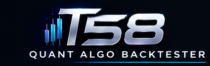
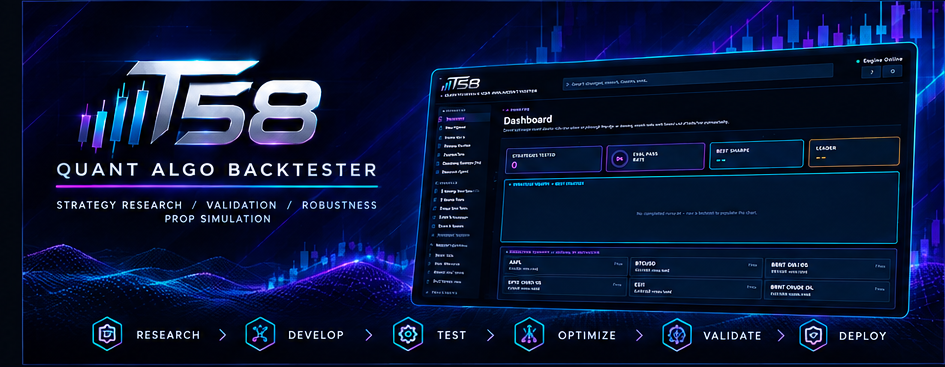
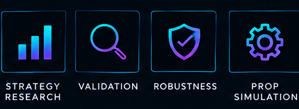
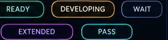
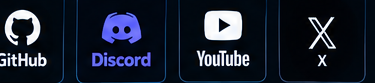

<p align="center">
  
</p>

<p align="center">
  <sub>STRATEGY RESEARCH &nbsp;/&nbsp; VALIDATION &nbsp;/&nbsp; ROBUSTNESS &nbsp;/&nbsp; PROP SIMULATION</sub>
</p>



<div align="center">

# T58 Trading — Quant Algo Backtester

</div>

---

Full Tutorial:
https://drive.google.com/file/d/1pO-jS8W7A2mh8HVCpxZ0Sd2h2AHaUeW_/view?usp=drivesdk

---

The one-stop shop for taking a trading idea from "here's a script" to
"here's a validated, prop-firm-ready strategy" — without leaving one app.
Import or write a strategy in any of four formats, validate it against real
prop-firm rules, search for a version that actually holds up out-of-sample,
optionally let a local AI help along the way, and walk away with one report
that answers the only question that actually matters:

> **"If I trade this strategy under these prop-firm rules, what is the probability that I pass the evaluation and reach my first payout?"**

This is a prop-firm-first backtester, not a traditional long-term investment
backtester. The core loop:

```
Market Data + Strategy + Risk + Prop Rules
        -> Historical Backtest
        -> Prop-Firm Simulation
        -> Monte Carlo Simulation (thousands of simulated accounts)
        -> Probability of Success
        -> Comprehensive Report
```

Everything else builds on that loop, organized into workflow stages:

- **Create** — Speed Run, Generate Strategies (AI), Research Agent
- **Test** — Run & Report, Payout Probability, Prop-Firm Recommender
- **Optimize** — Search Lab, Iterative Refinement, Full Pipeline, Quick
  Optimize, Multi-Objective Optimization, Evolution Lab
- **Validate** — Walk-Forward Optimization, Walk-Forward-Aware GA, CPCV /
  PBO, Parameter Sensitivity, Regime Survival Matrix
- **Champion** — Multi-Asset Portfolio, Multi-Strategy Ensemble, Family
  Diversity
- **Deployment** — Forward Test (MT5 demo), Overnight Autopilot,
  Auto-Retune, Deploy Live (connection management), Live Market monitor

<p align="center">
  
</p>


Plus **Quant Lab** (a dozen standalone analysis tools), **Options Outlook**,
an **AI Assistant** dashboard (news + market scanner + chat), and a
beginner-friendly **Resources** guide. An optional local **AI Assist**
(Ollama) can participate in several of these — see below.

Three ways to run it: a **Windows desktop app (.exe)**, a **local Python app**
(any OS), or a **mobile-friendly web app** you open in a phone browser.
Nearly every feature has full web/desktop parity — the exceptions (MT5-only
Deployment tools, a couple of small picker UIs) are called out where they
come up below.

## Running it

**Windows `.exe`, no Python needed:** push this repo to GitHub, then go to
**Actions → desktop-cross-platform → (latest run)** and download the
**T58-Quant-Algo-Backtester-Windows** artifact (macOS and Linux builds sit beside it; the web app is **web-cross-platform**). GitHub hands it to you as a
zip that contains `T58-Quant-Algo-Backtester-Windows.zip` — extract that
inner zip into a short folder such as `C:\T58\` and double-click
`T58-Quant-Algo-Backtester.exe` (keep the `_internal` folder beside it).
Market data is a **separate download** so the app stays small: take the
**T58-Market-Data** artifact from **Actions → build-data-pack** and extract
its `T58-Market-Data.zip` into the same folder as the `.exe`. Tagging a
release (`v*`) attaches the app zip, the data zip and their `.sha256`
checksums to a GitHub Release directly (no zip-inside-a-zip there).

**Local Python app (Windows/macOS/Linux):**

```bash
git clone <this-repo-url>
cd T58-Quant-Algo-Backtester
python3 -m venv .venv                 # Windows: py -m venv .venv
source .venv/bin/activate             # Windows: .venv\Scripts\activate.bat
pip install -r config/requirements.txt
python -m app.main                    # desktop GUI
```

Add `--cli --csv data/raw/EURUSD/EURUSD_5M_sample.csv --sims 10000` to run
headless instead; see `python -m app.main --help` for the full flag list.
Reports land in `reports/report.{json,html}` — `report.html` is
self-contained and print-to-PDF friendly.

**Mobile / web app:** Tkinter can't run on a phone, so mobile access is a
lightweight Flask web app reusing the exact same engine. Easiest path:
grab `T58-Web-App-Windows.zip` from [Releases](../../releases), run
`T58-Web-App.exe`, and scan the QR code it shows with your phone (same
Wi-Fi). From source instead: `python launchers/run_web.py`, which prints your LAN
address and a QR code. Away from home, [Tailscale](https://tailscale.com)
(free) lets your phone reach it from anywhere with no port forwarding —
details on the app's own **Phone access** page. Full walkthrough:
[`HOW_TO_OPEN_ON_YOUR_PHONE.md`](HOW_TO_OPEN_ON_YOUR_PHONE.md).

**Web app on any operating system (Windows, macOS, Linux):** the web app is
plain Python + Flask + a browser, so it runs anywhere Python 3.10+ does —
no Tk, no Windows-only packages (MetaTrader5/pywebview are installed on
Windows only, automatically). One command, same on every OS:

| OS | Start it |
| --- | --- |
| Windows | double-click `launchers\run_web.bat` |
| macOS | double-click `launchers/run_web.command` (first time: right-click → Open). If it won't open because the file lost its executable flag (happens when files are uploaded through the GitHub website), run `bash launchers/run_web.command` in Terminal once, or `chmod +x launchers/run_web.command launchers/run_web.sh` |
| Linux | `bash launchers/run_web.sh` |
| Any (manual) | `pip install -r config/requirements.txt` then `python launchers/run_web.py` |

The first run creates a private `.venv` and installs the dependencies; later
runs start immediately. If port 5000 is busy (macOS uses it for AirPlay
Receiver) the app automatically picks the next free port and shows the right
address and QR code. Where your data lives when the install folder is
read-only: Windows `%LOCALAPPDATA%`, macOS `~/Library/Application Support`,
Linux `~/.local/share` (folder `T58 Prop Algo Backtester`).
`python scripts/web_smoke_test.py` starts the real server and checks every
main page; the **web-cross-platform** GitHub Action runs the full test suite, that smoke
test on Windows, macOS and Linux, and (on pushes to main, tags and manual runs)
builds and smoke-tests one packaged web app per OS. **desktop-cross-platform**
does the same for the desktop app.

## Core workflow — Run & Report

1. **Upload Market Data** — CSV/TSV/Parquet/`.zip`/`.7z`, auto column
   mapping, gap/duplicate detection. Datasets (XAUUSD, EURUSD,
   GBPUSD, indices, etc.) live under `data/raw`. Multiple files can be
   selected for multi-timeframe analysis (e.g. 60m bias + 15m zone + 5m
   entry). Alpaca API fetch is also supported for US equities/crypto.

   **About downloads & data (buyers read this):** the full historical
   datasets under `data/raw/` ship as their own download,
   `T58-Market-Data.zip` (redistribution of this market data is licensed),
   which you extract into the app folder next to the `.exe`; the app zip
   itself carries only the small sample. You can also add more data any time after install: in the desktop
   app use the "Import folder..." button on the Market Data tab (or drag a
   folder onto the tab), and in the web app use the drag-and-drop folder
   zone in the Data Center -- every recognized file is run through the
   standard importer with per-file results.
2. **Import/Create a Strategy** — four formats, all reduced to the same
   standardized signal series:
   - **Manual Builder** — a full no-code visual builder: entry conditions
     across price/EMA/SMA/WMA/VWAP/RSI/MACD/ATR/Bollinger and
     market-structure concepts (swing highs/lows, liquidity sweeps, break
     of structure, fair value gaps, order blocks, session ranges); exits
     via fixed/ATR stops & targets, trailing stop, break-even, time-based
     exit, and more.
   - **Python** — upload/paste a `.py` exposing `generate_signals(df)`.
   - **PineScript** and **MQL5** — real parsers for a tested subset of each
     language (see below); anything unsupported fails loudly rather than
     producing a silently inaccurate backtest.

   Every strategy can be checked for **lookahead bias**, which re-runs
   signal generation on truncated data and flags the exact bar where a
   leak first appears. A persistent **Strategy Library** saves any
   strategy with status tags and its full backtest/search history.
3. **Enter Prop-Firm Rules** — account size, profit target, daily loss
   limit, max drawdown (trailing/static, intrabar/EOD), consistency rule,
   payout threshold/cap/frequency. **Quick-fill from a preset** — FTMO,
   Apex, TopStep, The5%ers, FundedNext, and Lucid rules are built in
   (dated, with a note on what to re-verify — firms change terms often).
4. **Configure Risk & Execution** — fixed-$ or %-of-equity risk per trade,
   commission, slippage, spread, pip size (with a "detect from data"
   helper).
5. **Backtest → Prop Simulation → Monte Carlo → Report** — one click, or
   the `--cli` flag.

## Create

- **Speed Run** — an all-in-one discover-to-verdict tool for a hard
  deadline: a fast, wide multi-family search feeding straight into Full
  Pipeline validation of the top survivors, picking the best
  READY/MARGINAL winner. If nothing clears the bar, it turns the run's own
  rejection reasons into concrete "what to try next" suggestions.
- **Generate Strategies (AI)** — a local Ollama model drafts a new
  strategy from a plain-language idea, saved to the library as a `draft`.
- **Research Agent** — a tool-calling AI that investigates a strategy over
  several reasoning steps, each a read-only call into this app's own
  engine (backtest, prop-sim, Monte Carlo, walk-forward, regime,
  sensitivity) — never an invented number.

## Test

- **Run & Report** — the core workflow above.
- **Payout Probability** — a lifecycle simulation carrying a strategy
  through funding milestones (eval pass → funded → payout #1 → payout #2
  → …), reporting a funnel of probabilities at each stage instead of one
  flat number. Includes an optional **account-scaling stress test**: model
  a funded account scaling up after a run of consecutive payouts (a common
  shape at several modern prop firms) and see how it changes your expected
  total payout.
- **Prop-Firm Recommender** — the reverse question: given your strategy's
  own trade sequence, scores it against every prop-firm preset (or a
  chosen subset) and returns a ranked table of which firm's rules it
  actually fits best, instead of checking one firm at a time by hand.

## Optimize

- **Search Lab** — discovers and validates *many* candidates in one run
  via a 5-stage funnel: generate a candidate pool from a named strategy
  family, cheap Stage-1 filter, GA refinement, a full validation gate
  (Monte Carlo + walk-forward holdout + robustness + Deflated Sharpe), then
  a leaderboard and champion promotion.
- **Iterative Refinement** — a genetic-algorithm parameter search across
  all four strategy sources, toward a configurable fitness metric.
- **Full Pipeline** — one button chaining baseline backtest → lookahead
  check → walk-forward-aware GA → re-validated report → OOS/holdout checks
  → a plain READY/MARGINAL/NOT READY verdict with reasons. Winners are
  auto-saved to the Strategy Library.
- **Quick Optimize** — a lighter, single-strategy version of the above.
- **Multi-Objective Optimization** — a real NSGA-II Pareto front across
  several objectives at once (e.g. Sharpe, drawdown, eval-pass
  probability) instead of collapsing them into one score.
- **Evolution Lab** — runs generate → filter → validate → keep-winners →
  mutate unattended, for as long as you leave it running, ranked by a
  composite **PROP FITNESS** score (pass probability × payout probability
  × robustness × OOS consistency, penalized for thin samples, overfitting,
  and concentration risk — not raw net profit). Every genome's backtest
  now runs under the same daily-loss/drawdown circuit breakers your prop
  rules define, so a candidate that would blow the account gets stopped
  during its own backtest rather than only being caught later. Checkpoints
  after every generation, so STOP-then-START resumes exactly where it left
  off. Candidates are Manual Strategy Builder configs, not mutated
  uploaded code.

## Validate

Five statistical-rigor tools answering different "how much should I trust
this backtest?" questions:

- **Walk-Forward Optimization** — rolling/anchored folds, a fresh GA per
  fold, chained into one continuous OOS equity curve.
- **Walk-Forward-Aware GA** — the same GA, scored only on chained OOS data
  so the search can't just curve-fit harder; reports an overfitting gap.
- **CPCV / PBO** — Combinatorial Purged Cross-Validation stress-tests one
  strategy across many train/test partitions; Probability of Backtest
  Overfitting checks a *pool* of candidates for whether the apparent best
  one is really better than a coin flip out-of-sample.
- **Parameter Sensitivity** — 1D sweeps of every tunable parameter with
  cliff detection, plus an optional 2D heatmap.
- **Regime Survival Matrix** — classifies every bar into a regime (trend,
  volatility, session, environment) and attributes the strategy's own
  trades to whichever regime was active, surfacing where its losers
  concentrate.

## The verdict ladder (the headline everywhere)

READY used to read as "buy the evaluation". It no longer does. Every page headlines one of five stages and shows the legacy
READY / MARGINAL / NOT READY label only as detail:

| Stage | Meaning | Reached by |
|---|---|---|
| REJECT | A hard gate failed, the pooled edge test FAILED, or the EV test says the fee is not worth it | backtest |
| LEAD | No hard failure, but the edge is not proven (thin trades, lower bound not above zero) | backtest |
| FORWARD-TEST CANDIDATE | Cleared the backtest gates and the EV test: permission to paper-trade under the SPRT monitor, nothing more | backtest |
| EVALUATE | The forward test accepted H1 (SPRT): buy the cheapest evaluation | recorded forward-test result only |
| FUNDED | Evaluation passed and a payout was received | recorded live facts only |

FORWARD-TEST CANDIDATE is the realistic output of a search. A backtest alone can never produce EVALUATE or FUNDED.

## Is there an edge? The pooled cross-market test

One strategy on one market at about 7 trades a month cannot prove a +0.10R edge in six years; that is a power problem, not strictness.
The primary edge question is therefore asked **pooled**: the same fixed parameters on 8-12 markets, R measured after 2x costs, one
day-block bootstrap over trading days across all markets (same-day moves in correlated markets stay in one block). Code:
`app/validation/pooled_edge.py` (`pooled_edge_test`, `pooled_family_test`, `cluster_t_stat`). Three questions stay separate: edge (this
test), survival (cost stress, regimes, holdout, ruin), and only then sizing / EV for the prop rules.

`app/validation/pipeline_controls.py` publishes positive and negative controls on the Dashboard: a zero-edge stream must almost never pass,
a planted +0.20-0.30R edge must usually be found, and pooling must beat a single market. If it does not, the pipeline is the problem.

Search Lab ranks on the lower bound of mean R after 2x costs (`edge_lb_r`), requires 100+ Stage-1 trades and a mean-R t-stat, skips
candidates whose round-trip cost exceeds 0.15R, and prints a random-entry control for every run (`app/search/run_controls.py`):
the share of RANDOM candidates that pass the same Stage-1 rule. Near-duplicate families are retired from "all" searches
(`RETIRED_FAMILIES` in `app/search/strategy_space.py`; an explicit single-family request still runs them).

## Data bootstrap

    python scripts/bootstrap_data.py

Rebuilds `data/data_manifest.json`, writes the FOMC/NFP calendar (2010 onward) and prints a loud banner for anything that weakens
results: files without an instrument spec (unmeasured costs), unreadable files, session-clock problems, and missing markets for the pooled
test (ES, NQ, YM, RTY, GC, CL, ZN, ZB, 6E, EURUSD, GBPUSD, USDJPY). Bar timestamps are stamped with `exchange_time` and `trading_day`
columns at import (`app/data/session_clock.py`); the bundled files are naive UTC and operands now read them as exchange time.

## How READY and the T58 score work

A strategy is **READY** when it clears **every hard gate** *and* its **T58 score is 75 or more**. READY means
"cleared the gates with a strong score", not "excellent on everything"; a score of **85+** earns the extra **Elite**
label. The gates are demote-only (a gate can lower a verdict, never raise it). Everything below is read from
`app/scoring/t58_scorecard.py`, `app/orchestration/full_pipeline.py` and `app/orchestration/audit_layers.py`.

Click any verdict pill (READY / MARGINAL / NOT READY) on the **Dashboard** or the **Champion** page to see, in plain
English, why that strategy got it.

### The T58 score (weights sum to 100)

| Score component | Weight | Measures |
|---|---:|---|
| Pass probability | 10 | Per-attempt Monte Carlo pass rate, trade-sample-aware lower bound |
| First payout (pass AND paid) | 8 | Same Monte Carlo, lower bound |
| Risk of ruin (inverted) | 6 | Evaluation-stage breach only |
| Funded survival (inverted) | 6 | Funded-stage breach only |
| Attempt replay pass | 15 | The real engine re-run from many real start dates (independent of the Monte Carlo) |
| Expectancy lower bound | 15 | Lower bound of average R per trade after 2x costs: 0R scores 0, 0.15R scores 100 |
| Walk-forward stability | 15 | Test metric / train metric, capped at 1.0 |
| Drawdown | 8 | Max drawdown as a share of the firm's drawdown limit |
| Monte Carlo robustness | 5 | Seed-to-seed spread of the pass rate |
| Parameter stability | 5 | Neighbour-parameter robustness |
| Parsimony | 4 | Fewer degrees of freedom scores higher |
| CPCV / PBO (supporting) | 3 | Out-of-sample retention across CPCV paths |

A component's share of the score is its weight / 100. (Older text said 120; that was the pre-audit card.)

The score is the weighted average over the components that were **measured** (a missing check is never scored as a
zero, and thin coverage caps the verdict instead). Tiers: **85+ Elite, 75+ Strong, 65+ Promising,
below 65 Reject.** Elite and Strong are READY (if every gate also passes), Promising is MARGINAL, Reject is NOT READY.

**T58 conformance is a badge, not a score term.** It measures how much of the entry logic is written in Market
Structure / Liquidity / Supply & Demand terms. That is a *style*, not survival, and prop firms do not score
vocabulary, so it is shown beside the score and **never** affects the score, the weight coverage or READY.

The four Monte Carlo components (pass, paid, ruin, funded survival) are capped at 30 of the 100 points because they come
from one resampled trade list; the other 70 points are evidence independent of it (replay, expectancy lower bound,
walk-forward, drawdown, robustness, parameter stability, parsimony, CPCV).

### The gates (defaults)

| Gate | Effect |
|---|---|
| Lookahead bias detected (or the check crashed) | NOT READY |
| Risk of ruin above 20% | NOT READY |
| Walk-forward not stable, CPCV not robust, ICIR fail, deflated Sharpe (PSR 0.95) fail, PBO above 0.5 | NOT READY |
| Per-attempt pass lower bound below 70% | NOT READY |
| Holdout (needs **30+ trades**) loses money **and** the upper 95% bound on per-trade expectancy is still below zero | NOT READY |
| Holdout loses money but the loss is not statistically convincing | Capped at MARGINAL |
| Fewer than **300** trades (`min_trades_for_ready`; the 100-trade preflight floor only decides whether the run is analysed at all); scorecard coverage below 70%; a core component missing | Capped at MARGINAL |
| Pass-and-paid lower bound below 35%; 30-day payout rate below 35% | Capped at MARGINAL |
| Random-entry null p above 0.10 | Capped at MARGINAL |
| **2× costs keep less than 25% of base net profit** (was: net profit of $1 passed) | Capped at MARGINAL |
| Seed spread above 10 points | Capped at MARGINAL |
| Attempt replay (**48** real start dates) disagrees with Monte Carlo: the two 95% intervals do not overlap **and** the gap is 10+ points | Capped at MARGINAL |
| No clean holdout, unverified firm rules, failed data gate, search-bias haircut | Capped at MARGINAL |

### What READY effectively asks for

Real scorecard runs at the gate floors (every other component set to the value shown, walk-forward 100):

| Pass lower bound | Paid lower bound | Ruin | Other components | Score | Verdict |
|---:|---:|---:|---:|---:|---|
| 70% | 35% | 20% | 80 | 72.9 | MARGINAL (Promising): gate floors alone are not enough |
| 80% | 45% | 10% | 85 | 80.0 | READY (Strong), if every gate also passes |
| 85% | 65% | 8% | 80 | 83.0 | READY (Strong), if every gate also passes |
| 90% | 60% | 5% | 90 | 87.1 | READY (Elite), if every gate also passes |

So READY now asks for the gates plus a score of 75: roughly 80-85% per-attempt pass lower bound, 45-65% paid lower
bound and ruin under about 10%, with decent (not perfect) secondary components. Elite (85+) is a label for
strategies that are excellent across the board. Public aggregates put real challenge pass rates around 10-20%, so
READY is still a top-percentile bar.

### Expected value beside READY

The EV verdict (HIGH CONFIDENCE / FORWARD-TEST CANDIDATE / NOT WORTH A FEE / INSUFFICIENT EVIDENCE) answers the
economic question: `EV = p × q × V − p × A − c`. For firms that charge a **monthly subscription** (Topstep's Trading
Combine, $49 per month) `c` is the monthly price × the months the evaluation is expected to take (median time to pass,
rounded up to whole 30-day periods), so slow passers are no longer priced as if they paid for one month.

### Speed switches

Monte Carlo runs vectorised across simulated paths (numpy only, bit-identical to the per-path loop; set
`T58_MC_VECTORIZE=0` to fall back). Lookahead results are cached on disk keyed on the strategy's content, the data and
the checker's code (`T58_LOOKAHEAD_DISK_CACHE=0` disables; `T58_CACHE_DIR` moves it). Python strategy modules are
loaded once per file version (`T58_MODULE_CACHE=0` disables; a strategy that keeps mutable module-level state declares
`T58_STATEFUL = True`). One persistent worker pool serves every Monte Carlo call, and a second persistent pool serves the search stages
(GA, walk-forward, deflated-Sharpe trials), so a Full Pipeline run spawns and imports its workers once, not per stage.
Backtests are memoized by effective parameter values (integer parameters that round equal share one run), and the
PBO gate scores its CPCV paths from the trade lists the deflated-Sharpe step already produced instead of
re-backtesting every path. Browser tabs stop polling while hidden.

## Champion

- **Multi-Asset Portfolio** — runs a strategy across several instruments,
  computes their correlation, re-weights risk, and merges legs into one
  shared account curve.
- **Multi-Strategy Ensemble** — combines several different,
  weakly-correlated strategies on the same instrument (blend or vote).
- **Family Diversity** — reports per-family performance from a Search Lab
  run, so you can see if the leaderboard is genuinely diverse.
- An **Automated Portfolio Composer** (under Quant Lab) searches the
  Strategy Library for the best N-strategy combination automatically.

Cost-stress-adjusted fitness (re-backtesting every GA candidate at
inflated spread/slippage/commission) and a declarative adaptive-risk
layer (de-risk after N losses, cut size on a bad day, coast near a profit
target) apply across every optimizer above.

## Deployment

- **Forward Test (MT5 demo)** — deploys any Strategy Library strategy to a
  free MT5 demo account and watches it trade forward against real broker
  prices, reusing the exact signal/sizing engine the backtester uses.
  Journals every trade, flags win-rate drift, ships a kill switch. Demo
  accounts only. Desktop-only (needs a running MT5 terminal).
- **Webhook Relay (TradingView)** — a TradersPost-style relay for forward
  testing a Pine Script strategy. Create a relay at `/webhook-relay`, paste
  its URL and the generated alert message into a TradingView alert on the
  strategy, and every order fill arrives as a webhook. Each signal is
  checked against the relay's rules (passphrase, allowed tickers, max
  quantity, duplicate filter, long/short), then applied to a T58 paper
  account (costs from the instrument specs) and, optionally, mirrored to a
  **demo** broker account (live accounts are refused). Web only. Needs a
  public https address for the app (ngrok, cloudflared or Tailscale Funnel)
  and a TradingView plan that supports webhooks; TradingView's own Paper
  Trading cannot receive webhooks, so the T58 paper account is the demo.
- **Overnight Autopilot** — chains Speed Run discovery straight into a
  live MT5 forward test of the winner: runs the search, and if it lands on
  a READY/MARGINAL strategy, starts forward-testing it automatically and
  writes one dated report to read in the morning. It can't finish a full
  forward-test evaluation overnight (that's a live, ongoing process) — what
  it gets you is "the search ran and a winner is already live on your demo
  account" instead of needing to babysit the search, then load, then start
  the forward test by hand. Desktop-only (same MT5 requirement as Forward
  Test); available from both the Forward Test tab and Speed Run.
- **Auto-Retune** — a one-click check against Strategy Health/Drift
  Monitor: if a running forward test's realized performance has drifted
  outside its predicted band, this re-runs Quick Optimize against it
  automatically and shows you the before/after, instead of you needing to
  notice the drift flag and start the re-tune by hand yourself.
- **Deploy Live** — connection management for a real, funded prop-firm
  account. **Actual live order placement is a deliberate stub** — this is
  connection/credential plumbing only, desktop-only, pending a proper
  authentication layer before going further.
- **Live Market monitor** — a read-only view of live bars/trades over your
  MT5/Alpaca connection.

## Quant Lab

A dozen standalone analysis tools: Universal Strategy Translator (Manual
config → clean PineScript v5 or MQL5), Auto Regime Selector, Strategy
Health / Drift Monitor, Automated Portfolio Composer, Pairs
Screener/Backtest, Options Pricing Calculator, Order Book Simulator,
Sentiment-Price Correlation, Portfolio Optimizer (Markowitz), Volatility
Surface, and Factor Model.

## Options Outlook & AI Assistant

**Options Outlook** generates deterministic call/put candidates via
Black-Scholes, with an optional Ollama-ranked narrative on top. The **AI
Assistant** dashboard combines a ForexFactory news panel, a best-markets
scanner, and chat, reading live bars from your MT5/Alpaca connection.

## Resources

A curated beginner's guide to trading fundamentals — market structure,
liquidity, supply & demand, entry models — for anyone who wants a running
start before backtesting their first strategy.

**Just bought the app?** Start with [docs/buyer/INSTALL.md](docs/buyer/INSTALL.md)
(Windows install + 15-minute first run) and
[docs/buyer/QUICKSTART.md](docs/buyer/QUICKSTART.md) (your first backtest in
10 minutes). The buyer pack also includes the EULA, refund policy, and
privacy policy templates plus the crash-reporting (Sentry) setup guide.

## AI Assist (optional, local Ollama)

Several tools above can optionally call a local [Ollama](https://ollama.com)
model — Full Pipeline's GA search, the Research Agent, Generate
Strategies, and Options Outlook/AI Assistant's narrative layer. Every
GA-relevant suggestion still passes through the same backtest → prop-sim →
Monte Carlo pipeline as any other candidate: the model proposes numbers
for already-discovered tunable parameters, never writes strategy code, and
can never displace a genuinely better candidate the GA already found.

**Setup:** install Ollama and pull a model (`ollama pull llama3.1`), then
check **Enable** and hit **Test Connection** wherever a page has an **AI
Assist** section. Off by default everywhere; an unreachable Ollama
degrades quietly rather than breaking the feature.

## Strategy format support

**PineScript (subset):** `open/high/low/close`, `input.int`/`input.float`,
`ta.sma`/`ta.ema`/`ta.wma`/`ta.rsi`, `ta.crossover`/`ta.crossunder`,
`strategy.entry`/`strategy.close` with `when=` conditions, and
`// T58_SL_PIPS=20` / `// T58_TP_PIPS=40` directive comments. Not
supported: custom functions, arrays, `security()`/multi-timeframe
requests, plotting/alerts.

**MQL5 (subset):** direct-value `iMA()`/`iRSI()` calls, C-style
conditions, `trade.Buy`/`trade.Sell`/`OrderSend()` for entries, the same
`T58_SL_PIPS`/`T58_TP_PIPS` directives. Not supported: `CopyBuffer()`
indicator handles, custom indicators, multi-symbol logic, trailing stops.

Both fail loudly with a clear error on anything unsupported, rather than
silently producing an inaccurate backtest.

## Tests

```bash
pytest -q tests
```

## Brand & assets

The desktop app, web app, and the reports both generate share one visual
identity — see `assets/brand/palette.md` for the exact colors. Strategy
Library statuses read at a glance the same way across both builds:

<p align="center">
  
</p>

<p align="center">
  
</p>

## Disclaimer

Simulated results are estimates derived from historical data and
resampling. Past performance and simulated outcomes do not guarantee
future results.
